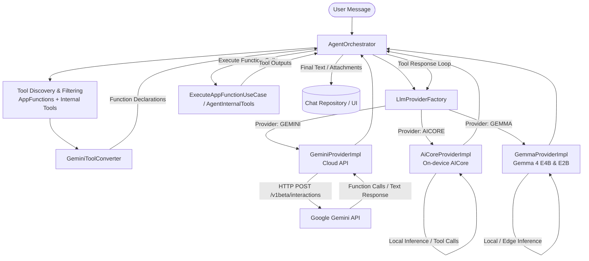

# LLM Integration Analysis in AppFunctions Agent

This document provides a comprehensive overview of how Large Language Models (LLMs) are integrated and utilized under the `agent` module.

---

## 1. Architectural Overview

The agent module uses an LLM to interpret user instructions, make tool-calling decisions, and execute actions via Android **AppFunctions** and built-in internal tools. Cloud-based (Gemini Cloud), On-Device (AICore / Gemini Nano), and Edge / On-Device (Gemma 4 E4B & E2B) providers are supported.

---

## 2. Key Components & Implementation Details

### 1. `AgentOrchestrator`
- **Location:** `agent/app/src/main/java/com/example/appfunctions/agent/domain/AgentOrchestrator.kt`
- **Responsibilities:**
  - **Message Processing:** Observes pending chat messages from the repository.
  - **Tool Discovery & Filtering:** Collects AppFunctions metadata from installed apps (`GetAppFunctionsUseCase`) and combines them with `AgentInternalTools`. Filters out disconnected/disabled tools.
  - **Interaction Loop (`runInteractionLoop`):**
    - Calls the LLM provider with user prompt or prior tool outputs.
    - If LLM returns tool calls (`function_call`), it resolves parameter types (e.g., downloading remote image URLs into local `content://` URIs and granting URI permissions), invokes the functions via `ExecuteAppFunctionUseCase` or `AgentInternalTools`, and loops back with tool outputs.
    - If LLM returns text response or finishes tool execution, updates the message state and sends assistant responses to the chat thread.

---

### 2. `LlmProvider` & `LlmProviderFactory`
- **Locations:**
  - `agent/app/src/main/java/com/example/appfunctions/agent/domain/LlmProvider.kt`
  - `agent/app/src/main/java/com/example/appfunctions/agent/data/LlmProviderFactoryImpl.kt`
- **Responsibilities:**
  - Defines the generic contract for LLM backends via `generateResponse(...)`.
  - Supports model selection, API key authentication, and service tier configuration (`STANDARD` vs `PRIORITY`).
  - Supports multiple LLM backends:
    - `LlmProviderName.GEMINI` -> `GeminiProviderImpl`
    - `LlmProviderName.AICORE` -> `AiCoreProviderImpl`
    - `LlmProviderName.GEMMA` -> `GemmaProviderImpl`

---

### 3. `GeminiProviderImpl` (Cloud)
- **Location:** `agent/app/src/main/java/com/example/appfunctions/agent/data/GeminiProviderImpl.kt`
- **Endpoint:** `https://generativelanguage.googleapis.com/v1beta/interactions` (Gemini Interactions API)
- **Responsibilities:**
  - **Multi-turn Context:** Maintains conversation state across turns via `previous_interaction_id`.
  - **System Prompting:** Injects system instructions enforcing natural conversational responses, date awareness, and image generation chaining behavior.
  - **Request/Response Parsing:** Formats tools into Gemini function schemas and parses API responses into typed `LlmResponsePart.Text` and `LlmResponsePart.ToolCall`.

---

### 4. `AiCoreProviderImpl` (On-Device AICore)
- **Location:** `agent/app/src/main/java/com/example/appfunctions/agent/data/AiCoreProviderImpl.kt`
- **SDK:** `com.google.mlkit:genai-prompt` (ML Kit GenAI Prompt API for Android AICore / Gemini Nano)
- **Responsibilities:**
  - **On-Device Inference:** Runs local Gemini Nano execution on supported Android devices through AICore via `Generation.getClient()`.
  - **Gemini-Compatible Tool Schema:** Utilizes `GeminiToolConverter` to declare AppFunction schemas in the system prompt identically to `GeminiProviderImpl`.
  - **Structured Function Calling:** Formats multi-turn history with `function_result` and parses model outputs into `LlmResponsePart.ToolCall` and `LlmResponsePart.Text`.
  - **Graceful Fallback:** Automatically falls back to local heuristic intent parsing when AICore is unavailable (e.g. in unit test environments or devices without AICore system services).

---

### 5. `GemmaProviderImpl` (Gemma 4 E4B / E2B On-Device & Edge)
- **Location:** `agent/app/src/main/java/com/example/appfunctions/agent/data/GemmaProviderImpl.kt`
- **Responsibilities:**
  - **Gemma 4 Execution:** Supports lightweight on-device models including `gemma-4-e4b` and `gemma-4-e2b`.
  - **Session & Turn Tracking:** Maintains local conversation history and multi-turn context.
  - **Function Calling:** Formats AppFunction schemas and handles tool execution intents locally.

---

### 6. `GeminiToolConverter`
- **Location:** `agent/app/src/main/java/com/example/appfunctions/agent/data/GeminiToolConverter.kt`
- **Responsibilities:**
  - Converts Android `AppFunctionMetadata` into function schema JSON objects.
  - Translates primitive and complex data types (string, integer, boolean, number, array, object).
  - Handles `android.net.Uri` and file reference parameter conversions.
  - Resolves component references and guards against circular references.

---

### 7. `AgentInternalTools`
- **Location:** `agent/app/src/main/java/com/example/appfunctions/agent/data/AgentInternalTools.kt`
- **Responsibilities:**
  - Exposes internal agent tools alongside third-party AppFunctions:
    - `getCurrentLocation`: Fetches device latitude and longitude.
    - `geocodeAddress`: Resolves postal addresses to latitude and longitude.
    - `generateImage`: Generates images and stores them as local content URIs for multi-step tool chaining (e.g. generating a wallpaper and setting it in a chat app).
