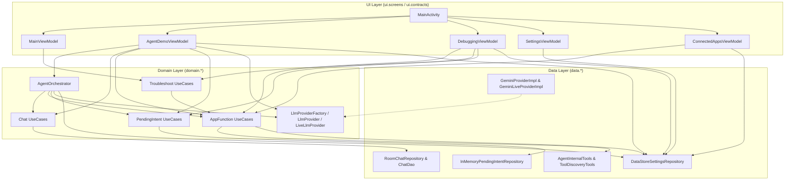
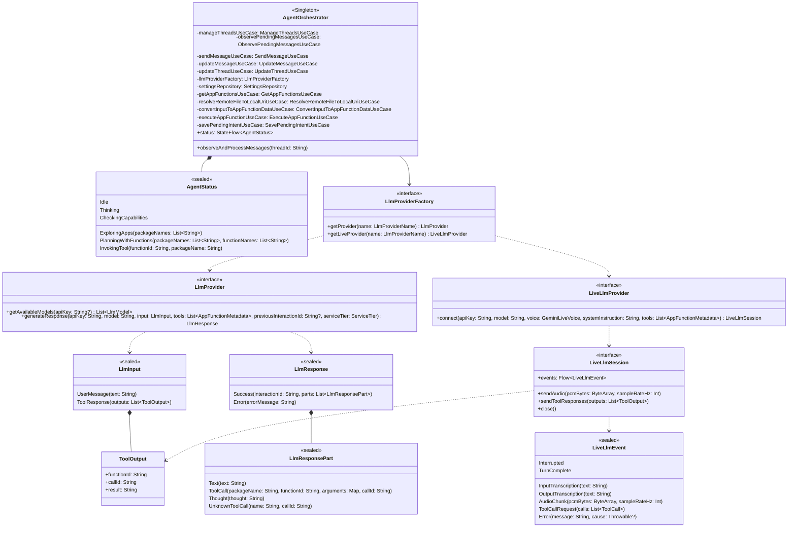
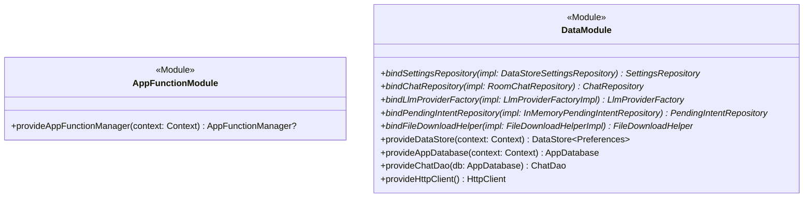

# UML Diagrams: `com.example.appfunctions.agent`

The source under [`com.example.appfunctions.agent`](file:///home/hdyoon/ml/appfunctions/agent/app/src/main/java/com/example/appfunctions/agent) follows a layered Android architecture (**UI → Domain → Data**) wired with Dagger Hilt (`di`).

> [!NOTE]
> Because the package contains ~80 files across 4 layers, the UML representation below is split into a **High-Level Architecture Overview** followed by detailed **UML Class Diagrams** for each layer:
> 1. **UI Layer & ViewModels** (`ui.*`, root activities)
> 2. **Domain Layer: Agent Orchestration & LLM Abstractions** (`domain.*`)
> 3. **Domain Layer: Feature Use Cases** (`domain.appfunction`, `domain.chat`, `domain.pendingintent`, `domain.troubleshoot`)
> 4. **Data Layer: Repositories, Room DB & Internal Tools** (`data.*`, `data.db.*`)
> 5. **Dependency Injection** (`di.*`)

---

## 1. High-Level Package & Dependency Architecture

---

## 2. UI Layer & ViewModels UML Class Diagram

Key files:
- [MainActivity.kt](file:///home/hdyoon/ml/appfunctions/agent/app/src/main/java/com/example/appfunctions/agent/MainActivity.kt), [AppFunctionsApplication.kt](file:///home/hdyoon/ml/appfunctions/agent/app/src/main/java/com/example/appfunctions/agent/AppFunctionsApplication.kt), [ShellIdentityInstrumentation.kt](file:///home/hdyoon/ml/appfunctions/agent/app/src/main/java/com/example/appfunctions/agent/ShellIdentityInstrumentation.kt)
- [MainViewModel.kt](file:///home/hdyoon/ml/appfunctions/agent/app/src/main/java/com/example/appfunctions/agent/ui/screens/main/MainViewModel.kt)
- [AgentDemoViewModel.kt](file:///home/hdyoon/ml/appfunctions/agent/app/src/main/java/com/example/appfunctions/agent/ui/screens/agentdemo/AgentDemoViewModel.kt), [AgentUiState.kt](file:///home/hdyoon/ml/appfunctions/agent/app/src/main/java/com/example/appfunctions/agent/ui/screens/agentdemo/AgentUiState.kt)
- [DebuggingViewModel.kt](file:///home/hdyoon/ml/appfunctions/agent/app/src/main/java/com/example/appfunctions/agent/ui/screens/debugging/DebuggingViewModel.kt), [DebuggingUiState.kt](file:///home/hdyoon/ml/appfunctions/agent/app/src/main/java/com/example/appfunctions/agent/ui/screens/debugging/DebuggingUiState.kt)
- [ConnectedAppsViewModel.kt](file:///home/hdyoon/ml/appfunctions/agent/app/src/main/java/com/example/appfunctions/agent/ui/screens/agentdemo/ConnectedAppsViewModel.kt), [SettingsViewModel.kt](file:///home/hdyoon/ml/appfunctions/agent/app/src/main/java/com/example/appfunctions/agent/ui/screens/agentdemo/SettingsViewModel.kt)

```mermaid
classDiagram
    class AppFunctionsApplication {
        <<HiltAndroidApp>>
    }

    class MainActivity {
        +onCreate(savedInstanceState: Bundle?)
    }

    class ShellIdentityInstrumentation {
        +onCreate(arguments: Bundle?)
        +onStart()
    }

    class MainViewModel {
        -checkAppFunctionPermissionUseCase: CheckAppFunctionPermissionUseCase
        -checkOsVersionUseCase: CheckOsVersionUseCase
        -checkMainlineVersionUseCase: CheckMainlineVersionUseCase
        +uiState: StateFlow~MainUiState~
        +checkAppStatus()
        +dismissDialog()
    }

    class MainUiState {
        +appStatus: AppStatus
        +showDialog: Boolean
    }

    class AppStatus {
        <<sealed>>
        Idle
        PermissionGranted
        PermissionMissing
        NotSupported
        InstrumentationFailed(error: String)
    }

    class AgentDemoViewModel {
        -getChatHistoryUseCase: GetChatHistoryUseCase
        -manageThreadsUseCase: ManageThreadsUseCase
        -sendMessageUseCase: SendMessageUseCase
        -agentOrchestrator: AgentOrchestrator
        -settingsRepository: SettingsRepository
        -llmProviderFactory: LlmProviderFactory
        -observeActivePendingIntentsUseCase: ObserveActivePendingIntentsUseCase
        -launchPendingIntentUseCase: LaunchPendingIntentUseCase
        -consumePendingIntentUseCase: ConsumePendingIntentUseCase
        -getInstalledAppsUseCase: GetInstalledAppsUseCase
        -getAppFunctionsUseCase: GetAppFunctionsUseCase
        +uiState: StateFlow~AgentUiState~
        +onEvent(event: AgentUiEvent)
    }

    class AgentUiState {
        <<sealed>>
        Loading
        Loaded(currentThread, messages, status, threads, activePendingActionIds, installedApps, availableModels)
    }

    class AgentUiEvent {
        <<sealed>>
        OnSendMessage(text: String, targetPackageName: String?)
        OnModelSelected(model: LlmModel)
        OnCreateThread(model: LlmModel)
        OnThreadSelected(threadId: String)
        OnConfirmAction(pendingIntentId: String)
    }

    class DebuggingViewModel {
        -getAppFunctionsUseCase: GetAppFunctionsUseCase
        -getAppFunctionStatesUseCase: GetAppFunctionStatesUseCase
        -convertInputToAppFunctionDataUseCase: ConvertInputToAppFunctionDataUseCase
        -executeAppFunctionUseCase: ExecuteAppFunctionUseCase
        -getInstalledAppsUseCase: GetInstalledAppsUseCase
        -troubleshootAppUseCase: TroubleshootAppUseCase
        -launchPendingIntentUseCase: LaunchPendingIntentUseCase
        -settingsRepository: SettingsRepository
        +uiState: StateFlow~DebuggingUiState~
        +onAppSelected(appInfo: AppInfo)
        +onClearSelectedApp()
        +onSearchQueryChanged(query: String)
        +onFunctionInputsChange(functionId: String, inputs: Map)
        +onFunctionExpandedChange(functionId: String, isExpanded: Boolean)
        +invokeFunction(function: AppFunctionMetadata)
        +clearResult()
        +launchPendingIntent(pendingIntent: PendingIntent)
        +onTogglePin(appInfo: AppInfo)
    }

    class DebuggingUiState {
        +filteredApps: AppsGroupState
        +selectedApp: AppInfo?
        +searchQuery: String
        +isLoading: Boolean
        +searchAppResultState: SearchAppResultState
    }

    class SearchAppResultState {
        <<sealed>>
        Idle
        FunctionsFoundState
        TroubleshootUiState
    }

    class ConnectedAppsViewModel {
        -getConnectedAppsUseCase: GetConnectedAppsUseCase
        -settingsRepository: SettingsRepository
        +uiState: StateFlow~ConnectedAppsUiState~
        +setAppConnected(packageName: String, isConnected: Boolean)
    }

    class ConnectedAppsUiState {
        +connectedApps: List~ConnectedAppInfo~
    }

    class SettingsViewModel {
        -settingsRepository: SettingsRepository
        +uiState: StateFlow~SettingsUiState~
        +saveSettings()
        +setSelectedProvider(provider: LlmProviderName)
        +setServiceTier(tier: ServiceTier)
        +setProgressiveToolDisclosure(enabled: Boolean)
    }

    class SettingsUiState {
        +selectedProvider: LlmProviderName
        +serviceTier: ServiceTier
        +progressiveToolDisclosure: Boolean
    }

    MainActivity ..> MainViewModel
    MainViewModel *-- MainUiState
    MainUiState *-- AppStatus
    AgentDemoViewModel *-- AgentUiState
    AgentDemoViewModel ..> AgentUiEvent
    DebuggingViewModel *-- DebuggingUiState
    DebuggingUiState *-- SearchAppResultState
    ConnectedAppsViewModel *-- ConnectedAppsUiState
    SettingsViewModel *-- SettingsUiState
```

---

## 3. Domain Layer: Orchestrator & LLM Abstractions

Key files:
- [AgentOrchestrator.kt](file:///home/hdyoon/ml/appfunctions/agent/app/src/main/java/com/example/appfunctions/agent/domain/AgentOrchestrator.kt), [AgentStatus.kt](file:///home/hdyoon/ml/appfunctions/agent/app/src/main/java/com/example/appfunctions/agent/domain/AgentStatus.kt)
- [LlmProviderFactory.kt](file:///home/hdyoon/ml/appfunctions/agent/app/src/main/java/com/example/appfunctions/agent/domain/LlmProviderFactory.kt), [LlmProvider.kt](file:///home/hdyoon/ml/appfunctions/agent/app/src/main/java/com/example/appfunctions/agent/domain/LlmProvider.kt), [LiveLlmProvider.kt](file:///home/hdyoon/ml/appfunctions/agent/app/src/main/java/com/example/appfunctions/agent/domain/LiveLlmProvider.kt), [LlmResponse.kt](file:///home/hdyoon/ml/appfunctions/agent/app/src/main/java/com/example/appfunctions/agent/domain/LlmResponse.kt)

---

## 4. Domain Layer: Use Cases (`appfunction`, `chat`, `pendingintent`, `troubleshoot`)

Key files:
- `domain/appfunction/`: [ExecuteAppFunctionUseCase.kt](file:///home/hdyoon/ml/appfunctions/agent/app/src/main/java/com/example/appfunctions/agent/domain/appfunction/ExecuteAppFunctionUseCase.kt), [GetAppFunctionsUseCase.kt](file:///home/hdyoon/ml/appfunctions/agent/app/src/main/java/com/example/appfunctions/agent/domain/appfunction/GetAppFunctionsUseCase.kt), [GetConnectedAppsUseCase.kt](file:///home/hdyoon/ml/appfunctions/agent/app/src/main/java/com/example/appfunctions/agent/domain/appfunction/GetConnectedAppsUseCase.kt), [ToolConverter.kt](file:///home/hdyoon/ml/appfunctions/agent/app/src/main/java/com/example/appfunctions/agent/domain/appfunction/ToolConverter.kt)
- `domain/chat/`: [ManageThreadsUseCase.kt](file:///home/hdyoon/ml/appfunctions/agent/app/src/main/java/com/example/appfunctions/agent/domain/chat/ManageThreadsUseCase.kt), [SendMessageUseCase.kt](file:///home/hdyoon/ml/appfunctions/agent/app/src/main/java/com/example/appfunctions/agent/domain/chat/SendMessageUseCase.kt), [GetChatHistoryUseCase.kt](file:///home/hdyoon/ml/appfunctions/agent/app/src/main/java/com/example/appfunctions/agent/domain/chat/GetChatHistoryUseCase.kt), [ObservePendingMessagesUseCase.kt](file:///home/hdyoon/ml/appfunctions/agent/app/src/main/java/com/example/appfunctions/agent/domain/chat/ObservePendingMessagesUseCase.kt), [UpdateMessageUseCase.kt](file:///home/hdyoon/ml/appfunctions/agent/app/src/main/java/com/example/appfunctions/agent/domain/chat/UpdateMessageUseCase.kt), [UpdateThreadUseCase.kt](file:///home/hdyoon/ml/appfunctions/agent/app/src/main/java/com/example/appfunctions/agent/domain/chat/UpdateThreadUseCase.kt)
- `domain/pendingintent/`: [SavePendingIntentUseCase.kt](file:///home/hdyoon/ml/appfunctions/agent/app/src/main/java/com/example/appfunctions/agent/domain/pendingintent/SavePendingIntentUseCase.kt), [ConsumePendingIntentUseCase.kt](file:///home/hdyoon/ml/appfunctions/agent/app/src/main/java/com/example/appfunctions/agent/domain/pendingintent/ConsumePendingIntentUseCase.kt), [LaunchPendingIntentUseCase.kt](file:///home/hdyoon/ml/appfunctions/agent/app/src/main/java/com/example/appfunctions/agent/domain/pendingintent/LaunchPendingIntentUseCase.kt), [ObserveActivePendingIntentsUseCase.kt](file:///home/hdyoon/ml/appfunctions/agent/app/src/main/java/com/example/appfunctions/agent/domain/pendingintent/ObserveActivePendingIntentsUseCase.kt)
- `domain/troubleshoot/`: [TroubleshootAppUseCase.kt](file:///home/hdyoon/ml/appfunctions/agent/app/src/main/java/com/example/appfunctions/agent/domain/troubleshoot/TroubleshootAppUseCase.kt), [CheckAppFunctionPermissionUseCase.kt](file:///home/hdyoon/ml/appfunctions/agent/app/src/main/java/com/example/appfunctions/agent/domain/troubleshoot/CheckAppFunctionPermissionUseCase.kt), [CheckMainlineVersionUseCase.kt](file:///home/hdyoon/ml/appfunctions/agent/app/src/main/java/com/example/appfunctions/agent/domain/troubleshoot/CheckMainlineVersionUseCase.kt), [CheckOsVersionUseCase.kt](file:///home/hdyoon/ml/appfunctions/agent/app/src/main/java/com/example/appfunctions/agent/domain/troubleshoot/CheckOsVersionUseCase.kt)

```mermaid
classDiagram
    %% AppFunction Use Cases
    class GetAppFunctionsUseCase {
        -appFunctionManager: AppFunctionManager?
        -getAppFunctionStatesUseCase: GetAppFunctionStatesUseCase
        -settingsRepository: SettingsRepository
        -agentInternalTools: AgentInternalTools
        +invoke(params: GetAppFunctionsParams) Flow~Map~
    }

    class ExecuteAppFunctionUseCase {
        -appFunctionManager: AppFunctionManager?
        -convertAppFunctionDataToJsonUseCase: ConvertAppFunctionDataToJsonUseCase
        -agentInternalTools: AgentInternalTools
        -grantAppFunctionUriPermissionsUseCase: GrantAppFunctionUriPermissionsUseCase
        -getAppFunctionsUseCase: GetAppFunctionsUseCase
        +invoke(functionMetadata: AppFunctionMetadata, parameters: AppFunctionData) ExecuteAppFunctionResult
    }

    class ExecuteAppFunctionResult {
        <<sealed>>
        Data(data: AppFunctionData, formattedJson: String)
        PendingIntentAction(pendingIntent: PendingIntent)
        ToolsDiscovered(formattedJson: String, tools: List~AppFunctionMetadata~)
        Error(exception: Exception)
    }

    class GetConnectedAppsUseCase {
        -getAppFunctionsUseCase: GetAppFunctionsUseCase
        -getInstalledAppsUseCase: GetInstalledAppsUseCase
        -settingsRepository: SettingsRepository
        +invoke() Flow~List~ConnectedAppInfo~~
    }

    class GetInstalledAppsUseCase {
        -context: Context
        +invoke() List~AppInfo~
    }

    class GetAppFunctionStatesUseCase {
        -context: Context
        +invoke(packageNames: Set~String~) Map~AppFunctionName, AppFunctionState~
    }

    class ConvertInputToAppFunctionDataUseCase {
        +invoke(functionMetadata: AppFunctionMetadata, inputMap: Map) Result~AppFunctionData~
    }

    class ConvertAppFunctionDataToJsonUseCase {
        +invoke(data: AppFunctionData, metadata: AppFunctionMetadata) String
    }

    class GrantAppFunctionUriPermissionsUseCase {
        -context: Context
        +invoke(targetPackageName: String, parameters: AppFunctionData, metadata: AppFunctionMetadata)
    }

    class ResolveRemoteFileToLocalUriUseCase {
        -fileDownloadHelper: FileDownloadHelper
        +invoke(functionMetadata: AppFunctionMetadata, inputs: Map) Map
    }

    class ToolConverter~T~ {
        <<interface>>
        +convert(tool: AppFunctionMetadata) T
        +getToolName(tool: AppFunctionMetadata) String
    }

    %% Chat Use Cases
    class GetChatHistoryUseCase {
        -chatRepository: ChatRepository
        +invoke(threadId: String) Flow~List~MessageEntity~~
    }

    class ManageThreadsUseCase {
        -chatRepository: ChatRepository
        +getThreads() Flow~List~ThreadEntity~~
        +getThread(threadId: String) Flow~ThreadEntity?~
        +createThread(llmModel: LlmModel) String
        +updateThreadModel(threadId: String, llmModel: LlmModel)
        +deleteThread(threadId: String)
    }

    class ObservePendingMessagesUseCase {
        -chatRepository: ChatRepository
        +invoke(threadId: String) Flow~MessageEntity~
    }

    class SendMessageUseCase {
        -chatRepository: ChatRepository
        +invoke(threadId: String, role: MessageRole, content: String, status: MessageProcessingStatus, pendingIntentId: String?, targetPackageName: String?, attachments: List~MessageAttachment~) String
    }

    class UpdateMessageUseCase {
        -chatRepository: ChatRepository
        +invoke(messageId: String, params: UpdateMessageParams)
    }

    class UpdateThreadUseCase {
        -chatRepository: ChatRepository
        +invoke(threadId: String, params: UpdateThreadParams)
    }

    %% PendingIntent Use Cases
    class SavePendingIntentUseCase {
        -pendingIntentRepository: PendingIntentRepository
        +invoke(pendingIntentId: String, pendingIntent: PendingIntent)
    }

    class ConsumePendingIntentUseCase {
        -pendingIntentRepository: PendingIntentRepository
        +invoke(pendingIntentId: String) PendingIntent?
    }

    class ObserveActivePendingIntentsUseCase {
        -pendingIntentRepository: PendingIntentRepository
        +invoke() StateFlow~Set~String~~
    }

    class LaunchPendingIntentUseCase {
        -context: Context
        +invoke(pendingIntent: PendingIntent)
    }

    %% Troubleshoot Use Cases
    class TroubleshootAppUseCase {
        -context: Context
        -getAppFunctionsUseCase: GetAppFunctionsUseCase
        +invoke(packageName: String) TroubleshootReport
    }

    class TroubleshootReport {
        +packageName: String
        +steps: List~TroubleshootStep~
    }

    class TroubleshootStep {
        +titleResId: Int
        +status: StepStatus
        +messageResId: Int?
        +messageArgs: List~String~
    }

    ExecuteAppFunctionUseCase ..> ExecuteAppFunctionResult
    ExecuteAppFunctionUseCase --> ConvertAppFunctionDataToJsonUseCase
    ExecuteAppFunctionUseCase --> GrantAppFunctionUriPermissionsUseCase
    ExecuteAppFunctionUseCase --> GetAppFunctionsUseCase
    GetAppFunctionsUseCase --> GetAppFunctionStatesUseCase
    GetConnectedAppsUseCase --> GetAppFunctionsUseCase
    GetConnectedAppsUseCase --> GetInstalledAppsUseCase
    TroubleshootAppUseCase --> GetAppFunctionsUseCase
    TroubleshootAppUseCase ..> TroubleshootReport
    TroubleshootReport *-- TroubleshootStep
```

---

## 5. Data Layer: Repositories, Room DB, LLM Providers & Internal Tools

Key files:
- Repositories: [ChatRepository.kt](file:///home/hdyoon/ml/appfunctions/agent/app/src/main/java/com/example/appfunctions/agent/data/ChatRepository.kt), [RoomChatRepository.kt](file:///home/hdyoon/ml/appfunctions/agent/app/src/main/java/com/example/appfunctions/agent/data/RoomChatRepository.kt), [SettingsRepository.kt](file:///home/hdyoon/ml/appfunctions/agent/app/src/main/java/com/example/appfunctions/agent/data/SettingsRepository.kt), [DataStoreSettingsRepository.kt](file:///home/hdyoon/ml/appfunctions/agent/app/src/main/java/com/example/appfunctions/agent/data/DataStoreSettingsRepository.kt), [PendingIntentRepository.kt](file:///home/hdyoon/ml/appfunctions/agent/app/src/main/java/com/example/appfunctions/agent/data/PendingIntentRepository.kt), [InMemoryPendingIntentRepository.kt](file:///home/hdyoon/ml/appfunctions/agent/app/src/main/java/com/example/appfunctions/agent/data/InMemoryPendingIntentRepository.kt)
- Room DB: [AppDatabase.kt](file:///home/hdyoon/ml/appfunctions/agent/app/src/main/java/com/example/appfunctions/agent/data/db/AppDatabase.kt), [ChatDao.kt](file:///home/hdyoon/ml/appfunctions/agent/app/src/main/java/com/example/appfunctions/agent/data/db/dao/ChatDao.kt), [MessageEntity.kt](file:///home/hdyoon/ml/appfunctions/agent/app/src/main/java/com/example/appfunctions/agent/data/db/entities/MessageEntity.kt), [ThreadEntity.kt](file:///home/hdyoon/ml/appfunctions/agent/app/src/main/java/com/example/appfunctions/agent/data/db/entities/ThreadEntity.kt)
- LLM & Tools: [LlmProviderFactoryImpl.kt](file:///home/hdyoon/ml/appfunctions/agent/app/src/main/java/com/example/appfunctions/agent/data/LlmProviderFactoryImpl.kt), [GeminiProviderImpl.kt](file:///home/hdyoon/ml/appfunctions/agent/app/src/main/java/com/example/appfunctions/agent/data/GeminiProviderImpl.kt), [GeminiLiveProviderImpl.kt](file:///home/hdyoon/ml/appfunctions/agent/app/src/main/java/com/example/appfunctions/agent/data/GeminiLiveProviderImpl.kt), [GeminiToolConverter.kt](file:///home/hdyoon/ml/appfunctions/agent/app/src/main/java/com/example/appfunctions/agent/data/GeminiToolConverter.kt), [GeminiLiveToolConverter.kt](file:///home/hdyoon/ml/appfunctions/agent/app/src/main/java/com/example/appfunctions/agent/data/GeminiLiveToolConverter.kt), [AgentInternalTools.kt](file:///home/hdyoon/ml/appfunctions/agent/app/src/main/java/com/example/appfunctions/agent/data/AgentInternalTools.kt), [ToolDiscoveryTools.kt](file:///home/hdyoon/ml/appfunctions/agent/app/src/main/java/com/example/appfunctions/agent/data/ToolDiscoveryTools.kt), [FileDownloadHelper.kt](file:///home/hdyoon/ml/appfunctions/agent/app/src/main/java/com/example/appfunctions/agent/data/FileDownloadHelper.kt)

```mermaid
classDiagram
    %% Repositories & Database
    class ChatRepository {
        <<interface>>
        +getMessagesForThread(threadId: String) Flow~List~MessageEntity~~
        +sendMessage(message: MessageEntity)
        +updateMessageStatus(messageId: String, status: MessageProcessingStatus)
        +createThread(thread: ThreadEntity)
        +updateThreadModel(threadId: String, llmModel: LlmModel)
        +getThreads() Flow~List~ThreadEntity~~
        +getThread(threadId: String) Flow~ThreadEntity?~
        +deleteThread(threadId: String)
        +getLatestInteractionId(threadId: String) Flow~String?~
        +updateLatestInteractionId(threadId: String, interactionId: String)
        +getThreadByInteractionId(interactionId: String) Flow~ThreadEntity?~
    }

    class RoomChatRepository {
        -chatDao: ChatDao
    }

    class AppDatabase {
        <<abstract>>
        +chatDao() ChatDao
    }

    class ChatDao {
        <<interface>>
        +getMessagesForThread(threadId: String) Flow~List~MessageEntity~~
        +insertMessage(message: MessageEntity)
        +updateMessageStatus(messageId: String, status: MessageProcessingStatus)
        +insertThread(thread: ThreadEntity)
        +updateLatestInteractionId(threadId: String, interactionId: String)
        +updateThreadModel(threadId: String, llmModel: LlmModel)
        +getThreads() Flow~List~ThreadEntity~~
        +getThread(threadId: String) Flow~ThreadEntity?~
        +deleteThread(threadId: String)
    }

    class ThreadEntity {
        +id: String
        +createdAt: Long
        +llmModel: LlmModel
        +latestInteractionId: String?
    }

    class MessageEntity {
        +id: String
        +threadId: String
        +role: MessageRole
        +textContent: String
        +timestamp: Long
        +processingStatus: MessageProcessingStatus
        +pendingIntentId: String?
        +targetPackageName: String?
        +attachments: List~MessageAttachment~
    }

    class SettingsRepository {
        <<interface>>
        +geminiApiKey: Flow~String?~
        +selectedProvider: Flow~LlmProviderName~
        +serviceTier: Flow~ServiceTier~
        +progressiveToolDisclosure: Flow~Boolean~
        +geminiLiveVoice: Flow~GeminiLiveVoice~
        +pinnedApps: Flow~Set~String~~
        +disconnectedApps: Flow~Set~String~~
        +setGeminiApiKey(apiKey: String)
        +setSelectedProvider(provider: LlmProviderName)
        +setServiceTier(tier: ServiceTier)
        +setProgressiveToolDisclosure(enabled: Boolean)
        +setGeminiLiveVoice(voice: GeminiLiveVoice)
        +setAppPinned(packageName: String, pinned: Boolean)
        +setAppConnected(packageName: String, connected: Boolean)
    }

    class DataStoreSettingsRepository {
        -dataStore: DataStore~Preferences~
    }

    class PendingIntentRepository {
        <<interface>>
        +pendingIntentIds: StateFlow~Set~String~~
        +savePendingIntent(pendingIntentId: String, pendingIntent: PendingIntent)
        +consumePendingIntent(pendingIntentId: String) PendingIntent?
    }

    class InMemoryPendingIntentRepository {
        -pendingIntents: ConcurrentHashMap~String, PendingIntent~
    }

    class FileDownloadHelper {
        <<interface>>
        +downloadToLocalUri(url: String) String
    }

    class FileDownloadHelperImpl {
        -context: Context
        -httpClient: HttpClient
    }

    %% LLM Provider Implementations
    class LlmProviderFactoryImpl {
        -geminiProvider: GeminiProviderImpl
        -geminiLiveProvider: GeminiLiveProviderImpl
        +getProvider(name: LlmProviderName) LlmProvider
        +getLiveProvider(name: LlmProviderName) LiveLlmProvider
    }

    class GeminiProviderImpl {
        -httpClient: HttpClient
        -toolConverter: GeminiToolConverter
        +getAvailableModels(apiKey: String?) List~LlmModel~
        +generateResponse(apiKey, model, input, tools, previousInteractionId, serviceTier) LlmResponse
    }

    class GeminiLiveProviderImpl {
        -toolConverter: GeminiLiveToolConverter
        -webSocketConnector: WebSocketConnector
        +connect(apiKey, model, voice, systemInstruction, tools) LiveLlmSession
    }

    class GeminiToolConverter {
        +convert(tool: AppFunctionMetadata) JsonObject
        +getToolName(tool: AppFunctionMetadata) String
    }

    class GeminiLiveToolConverter {
        -geminiToolConverter: GeminiToolConverter
        +convert(tool: AppFunctionMetadata) JsonObject
        +getToolName(tool: AppFunctionMetadata) String
    }

    %% Internal Tools
    class AgentInternalTools {
        -context: Context
        -httpClient: HttpClient
        -settingsDataStore: DataStore~Preferences~
        -toolDiscoveryTools: ToolDiscoveryTools
        +geocodeAddress(address: String) LatLng?
        +getCurrentLocation() LatLng?
        +generateImage(prompt: String) GeneratedImageResult
        +getInternalToolsMetadata() List~Pair~
        +buildToolDiscoveryTools(apps: Map) List~AppFunctionMetadata~
        +executeInternalTool(functionMetadata: AppFunctionMetadata, parameters: AppFunctionData) AppFunctionData
    }

    class ToolDiscoveryTools {
        -context: Context
        +buildTools(apps: Map) List~AppFunctionMetadata~
        +execute(functionMetadata: AppFunctionMetadata, parameters: AppFunctionData) Pair
        +isToolDiscoveryTool(function: AppFunctionMetadata) Boolean
    }

    class AbstractFakeAppFunctionService {
        <<abstract>>
        +fakeFunction(params: FakeParams) FakeResponse
    }

    ChatRepository <|.. RoomChatRepository
    RoomChatRepository --> ChatDao
    AppDatabase ..> ChatDao
    ChatDao ..> ThreadEntity
    ChatDao ..> MessageEntity
    ThreadEntity "1" *-- "many" MessageEntity : threadId

    SettingsRepository <|.. DataStoreSettingsRepository
    PendingIntentRepository <|.. InMemoryPendingIntentRepository
    FileDownloadHelper <|.. FileDownloadHelperImpl

    LlmProviderFactoryImpl --> GeminiProviderImpl
    LlmProviderFactoryImpl --> GeminiLiveProviderImpl
    GeminiProviderImpl --> GeminiToolConverter
    GeminiLiveProviderImpl --> GeminiLiveToolConverter
    GeminiLiveToolConverter --> GeminiToolConverter
    AgentInternalTools --> ToolDiscoveryTools
```

---

## 6. Dependency Injection (`di`)

Key files:
- [AppFunctionModule.kt](file:///home/hdyoon/ml/appfunctions/agent/app/src/main/java/com/example/appfunctions/agent/di/AppFunctionModule.kt)
- [DataModule.kt](file:///home/hdyoon/ml/appfunctions/agent/app/src/main/java/com/example/appfunctions/agent/di/DataModule.kt)

